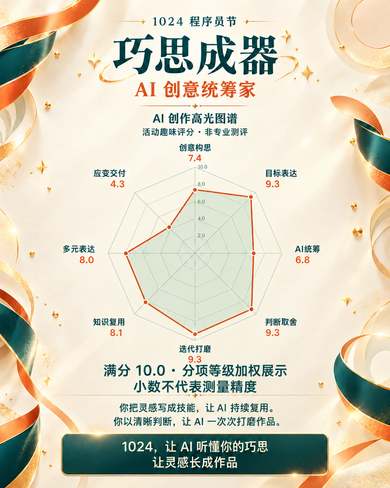

# 一句话，生成你的 1024 程序员节礼物

把你如何提出想法、组织 AI、推动作品完成，做成一张专属的 **AI 高光海报**。这是一个供 AI Agent 使用的 Skill，以 `SKILL.md` 和配套资源描述工作流；安装位置和调用方式由当前 Agent 环境决定。

## 让 Agent 直接安装并生成

把下面这一句话发给具备联网和文件操作权限的 Agent：

```text
请安装 https://github.com/dusthappy/1024 中的 programmer-day-1024 技能到你当前支持的技能目录，确认可用后，为我生成一份带八维雷达图、夸赞关键词和专属口号的 1024 程序员节礼物。
```

已经安装后，直接说：

```text
请使用 programmer-day-1024，送我一份专属的 1024 程序员节礼物：用八维雷达图、夸赞关键词和一句口号，做成我的 AI 高光海报。
```

支持显式技能命令的 Agent，也可以使用其原生调用方式，例如 `$programmer-day-1024`。没有持久安装能力时，可让 Agent 读取技能入口及其引用资源后在当前会话执行；这不等于已完成安装。

## 一次真实生成的礼物



这是按 **`1024-8d-v3`** 重新核对可见用户行为后生成的真实海报：称号、夸赞关键词、能力短句、口号与八维雷达图融入同一张礼物。先按分项判级计算并冻结数值，再生成精确图表参考，调用生图工具完成海报，并检查文字、八维数字、顺序及点位比例。

图表标题附近标明“活动趣味评分 · 非专业测评”，图表下方清楚显示“满分 10.0 · 分项等级加权展示”和“小数不代表测量精度”。**文案和分数来自这次可见证据，不是所有用户的固定模板，也不是能力排名。** 相同分数可以来自不同分项证据；没有为了图形起伏人为拉开差距。

[查看完整 PNG](docs/demo/1024-poster-v3.png) · [查看对应图表数据](docs/demo/chart-data-v3.json)

| 创意构思 | 目标表达 | AI统筹 | 判断取舍 | 迭代打磨 | 知识复用 | 多元表达 | 应变交付 |
| --- | --- | --- | --- | --- | --- | --- | --- |
| 7.4 | 9.3 | 6.8 | 9.3 | 9.3 | 8.1 | 8.0 | 4.3 |

图表数据只包含规则版本和八维分值，不包含用户记忆原文或私人证据台账。旧版海报和虚构数据的独立图表示例已从当前版本移除。

## 安装方式

### 交给 Agent 安装（推荐）

上面的安装指令包含仓库地址和技能目录。Agent 应按当前环境支持的方式完成安装：

1. 识别当前 Agent 的技能机制、已配置的技能目录和权限范围，优先使用环境自带的技能安装器。
2. 从本仓库获取完整的 `programmer-day-1024/` 目录，保留 `SKILL.md`、`agents/`、`references/` 和 `scripts/` 的相对结构。
3. 按实际环境完成安装或注册；若已有同名技能，先检查版本和本地修改，再处理更新。
4. 验证入口和引用资源可读，以及当前 Agent 能否发现或调用该技能，并告知实际安装位置。只有下载成功时，不应宣称已经安装可用。

不同 Agent 的目录、注册与刷新方式可能不同，不能把某一个产品的路径当作通用标准。若当前环境不支持安装或缺少必要权限，Agent 应说明限制，并提供适合该环境的使用方法。

### 手动安装

1. 在 [dusthappy/1024](https://github.com/dusthappy/1024) 选择 **Code → Download ZIP**，下载并解压。
2. 将完整的 `programmer-day-1024/` 目录放入当前 Agent 文档或配置指定的技能目录，并按该环境要求完成注册或刷新。
3. 确认 `SKILL.md` 与配套资源可读，再使用上方的一句话生成礼物。

目录结构示意如下，尖括号部分需替换为当前环境的实际路径：

```text
<当前 Agent 的技能目录>/programmer-day-1024/SKILL.md
```

保留同级的 `agents/`、`references/` 和 `scripts/`，不要只复制入口文件，也不要多嵌套一层同名目录。部分环境只使用其中的元数据；核心工作流以 [SKILL.md](programmer-day-1024/SKILL.md) 为准，工具能力和权限以实际运行环境为准。

## 这份礼物如何生成

技能结合当前可见且有权限访问的技能、用户记忆与对话，提炼高光称号、夸赞关键词、能力短句和一句专属口号，并将八维雷达图融入海报。

有可用生图工具时优先生图；没有生图能力、生成失败或图表修正后仍不准确时，交付完整 SVG 海报。没有文件工具时可直接交付 SVG 源码，也支持指定只要文字。

固定八维为：**创意构思、目标表达、AI统筹、判断取舍、迭代打磨、知识复用、多元表达、应变交付**。

每维满分 **10.0**，统一保留一位小数。规则版本为 `1024-8d-v3`：维度指标 A、B 各占 25%，复杂要求处理 C 占 20%，实际成效 E 占 30%；先固定可见用户行为的证据范围，按 [相邻等级校准例](programmer-day-1024/references/rating-calibration.md) 逐格判定 0–4 级，再使用十进制四舍五入计算。v3 保留原有权重与公式，补齐判级门槛、证据裁决和图中精度说明；旧评级须复核，不能只改版本号。

一位小数是**整数等级的加权显示，不是 0.1 分的测量精度**。600 个有效评级组合只产生 68 种可达分值，不支持任意微调尾数，也不凭微小分差判断能力高低。相同整数评级的计算可复现，独立 Agent 首次判读自然语言的主观性仍存在；目前没有正式的评审者一致率数据。

这是基于当前可见证据的**活动趣味评分，不是专业能力测评或排名**。缺少直接用户证据的维度显示“待探索”，不会凭空补分，也不会把 Agent 的工具数量或自主操作算作用户能力。图表与数值来自同一份数据。

技能只读取当前可见且有权限的信息。公开绘图数据不包含用户记忆原文或完整证据记录。

## 评分与雷达图脚本

两个脚本需要 Python 3.9 或更新版本，仅依赖标准库。在技能目录下运行：

```sh
cd programmer-day-1024
python3 scripts/score_profile.py --input rating-input.json --output chart-data.json
python3 scripts/render_radar.py --input chart-data.json --output radar.svg --theme light
```

- `score_profile.py`：校验完整八维的 A、B、C、E 整数评级，计算一位小数分数；没有直接依据的整维输出 `null`。
- `render_radar.py`：依据冻结分数生成精确 SVG 雷达图，支持 `light`、`dark` 配色。输出是图表组件，仍需与称号、能力短句和口号组成完整海报。

脚本默认拒绝覆盖已有输出，明确需要重建时可加 `--force`。输入格式、等级定义、计算公式和图表要求见 [评分与图表规则](programmer-day-1024/references/scoring-and-chart.md)；文案与视觉方法见 [用户高光表达](programmer-day-1024/references/portrait-framework.md)。

维护者可在仓库根目录运行 `python3 -B -m unittest discover -s tests -v`，检查完整评级组合、四舍五入、版本校验、缺失轴几何及图中说明的可见性。它验证实现合同，不代替真实用户证据的判级一致性研究。

## 仓库结构

```text
README.md
docs/demo/
├── 1024-poster-v3.png
└── chart-data-v3.json
programmer-day-1024/
├── SKILL.md
├── agents/openai.yaml
├── references/
│   ├── portrait-framework.md
│   ├── rating-calibration.md
│   └── scoring-and-chart.md
└── scripts/
    ├── score_profile.py
    └── render_radar.py
tests/
└── test_scoring_contract.py
```
